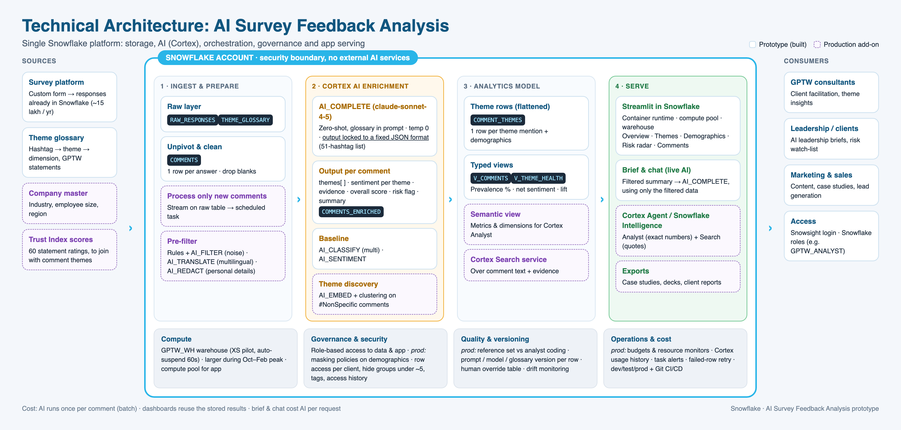

# GPTW AI Summary Insights

AI-powered employee survey feedback analysis on Snowflake. Snowflake Cortex AI tags each open-ended survey comment with the themes it mentions from the GPTW glossary (hashtag → theme → dimension). Each tag gets its own sentiment and a supporting phrase from the comment, and the results are explored in a Streamlit in Snowflake dashboard. All data and AI processing stay inside your Snowflake account.

## Files

| File | Purpose |
|---|---|
| `setup.sql` | End-to-end setup: tables, Cortex AI enrichment, analytics views, app deployment, grants |
| `streamlit_app.py` | Dashboard: Overview, Themes, Demographics, Risk radar, Leadership brief, Ask the data, Comments |
| `pyproject.toml` | App dependencies (container runtime) |
| `GPTW_Deployment_Guide.png` | Step-by-step deployment reference |
| `GPTW_Technical_Architecture.png` | Technical architecture |
| `deployment_guide.html`, `technical_architecture.html` | Editable sources for the diagrams |

## Quick start

1. **Prerequisites:**
   - Run as ACCOUNTADMIN (or an equivalent role).
   - Grant the role `SNOWFLAKE.CORTEX_USER`.
   - Confirm `claude-sonnet-4-5` is available in your region, or enable cross-region inference after reviewing data residency.
2. **Open `setup.sql` in a Snowsight worksheet and run the steps in order:**
   1. Load the theme glossary into `THEME_GLOSSARY`.
   2. Map your survey table to `RAW_RESPONSES` (a view template is included).
   3. Build `COMMENTS` (one row per comment).
   4. Run the AI step (`COMMENTS_ENRICHED`). Test on 10 rows first.
   5. Build the analytics tables and views (`COMMENT_THEMES`, `V_COMMENTS`, `V_THEME_HEALTH`).
   6. Upload `streamlit_app.py` and `pyproject.toml` to `@GPTW_DEMO.SURVEY.APP_STAGE/app` and create the app.
   7. Grant access to your analysts' role.
3. **Open the app:** Snowsight → Projects → Streamlit → *GPTW Survey AI Insights*. The first start takes a few minutes.

## Cost guide

- **AI step:** roughly 0.006 credits per comment with `claude-sonnet-4-5`. It runs once per comment, and dashboard views reuse the stored results.
- **Prototype build:** the 866-comment prototype used about 7–8 credits in total.
- **App hosting:** the app uses an XS compute pool while it's running and shuts down after 1 idle day.
